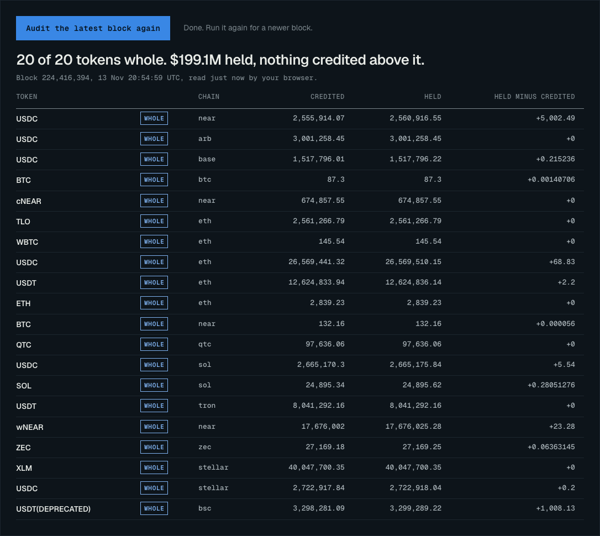

# Waterline

**NEAR Intents can be audited from outside, to the last unit, at any block. Its private chain cannot.**
Waterline is that audit, and an investment thesis for NEAR built on it. Two questions to two contracts show
whether NEAR Intents holds what it has credited. Asked at the pinned block: 214 tokens, $223.8M, none short.
Asked over past blocks: the October 2026 exploit is in the public books 31 hours 40 minutes before the first
payout, at ten dollars at first and at $1.3M by the end. The audit stops at one account, the private chain's
treasury, which now holds 61.0% of everything.



**Dated tests, results so far.** Every test was written and hashed before its reading existed. This table is
written by the scoring code, not typed:

<!-- results:start -->
| Test | Reading | Result |
| --- | --- | --- |
| G1: no tracked token is short | 2026-11-14 | **PASS** |
| E1: the float is at least what it was on 2026-11-13 ($136.4M) | 2026-11-14 | **FAIL**: it was $135.2M |
| E2: no single day adds another lump | 2026-11-14 | **PASS** |
| E3: the private share of the tracked tokens is at least 60.0% | 2026-11-14 | **PASS**: 61.9% |

Scored by code and still pending: 4 on the 2026-11-17 reading, 6 on the 2027-03-31 reading. Two more, R4 and D1, are scored by hand on 2027-03-31. `make score` prints every test.
<!-- results:end -->

## The thesis in short

**Rating: Hold, small, to the end of 2029.** Up to 1% of a liquid portfolio, moved by a rule whose inputs this
repository reads from the chain ([`THESIS.md`](THESIS.md), section 5).

1. NEAR Intents' public books can be proven whole by anyone, at any block, in two calls per token. Today they
   are: 214 tokens, $223.8M, none short.
2. The one time they were not, it showed: the October hole was in the books from ten dollars 31 hours 40 minutes before the
   first payout, and above $10,000 1 hour 9 minutes before it. A replay run in November, not live detection; the start time
   is also CertiK's.
3. The swaps now settle through the one account the audit cannot see into: for 9 of 9 completed 1Click swaps we
   found, the swap's own record lists the transaction that moved its tokens into it. That account holds 61.0% of
   everything NEAR Intents holds.
4. NEAR's buyback is funded by revenue we read from the chain: 426,685 NEAR in the last 30 days, 16% of net new supply.
   For buybacks to match new supply by the end of 2029 that revenue, counted in NEAR, has to grow 84% a year, or 59% a year
   if HSP-029 takes effect. Over the latest 30 days against the 30 before it was -17%.
5. What sits behind the private chain is partly paid for and moves in lumps: NEAR pays a reward for confidential
   balances, 94% of the net NEAR that arrived in late September came from one account, and half of the float's
   best day was money the treasury had paid out the evening before.
6. The rule: add, up to 3%, if coverage reaches 25% in two 30-day windows in a row or NEAR publishes the private
   chain's totals; exit if a hole in the public books stays open beyond 3 readings, the audit stops working, or
   coverage falls below 10% in two windows in a row. Dated tests are hashed and scored by code:
   [`PREREG-AUDIT.md`](PREREG-AUDIT.md) for the audit, and [`PREREG.md`](PREREG.md) for this project's first
   question, the growth of the private side.

## Try it

| Do | See |
| --- | --- |
| `make test` | `OK` after the unit tests. No network. Under a second. |
| `make check` | Every derived file, the table above and the numbers in the page are rebuilt in memory and compared with what is committed; every number in the prose is checked. Ends with `RESULT: PASS`. No network, writes nothing. |
| `make verify` | First re-reads 8 days from a public NEAR archival node (balances, the largest totals, the supply headers, the treasury's keys), then does everything `make check` does. Three to fifteen minutes, depending on how hard the public node is rate-limiting. |
| `make tomorrow` | Adds a made-up next day to a temporary copy of the repository and runs the checks there. Prints one `ok` line if no quoted number depends on days after the pinned one. No network, about seven seconds. It is what the daily dashboard job relies on. |
| `make score` | The forward tests in [`PREREG.md`](PREREG.md) and [`PREREG-AUDIT.md`](PREREG-AUDIT.md), each `PASS`, `FAIL`, `UNKNOWN` or `PENDING` until its reading exists. |
| `make audit` | Audits the 20 largest tokens at the latest final block: what `intents.near` has credited against what each token's contract says it holds. Prints one line per token and `RESULT: WHOLE`; exit code 1 and the tokens concerned if any is short; `RESULT: INCOMPLETE` and exit code 2 if any total could not be read. About 25 requests: under a minute on a quiet node, a few minutes when it rate-limits. `python3 -m pipeline.audit` prints the audit of every stored day with no network. |
| `make trace` | Halves the day before the 25 September reading down to the one block where the treasury's NEAR balance jumped, then prints the receipt behind it: who signed it, for how much. About 25 requests to a public archival node, about a minute. `python3 -m pipeline.trace --help` lists the settings (`--account`, `--token`, `--top`). |
| `python3 -m pipeline.revenue` | The three revenue wallets' NEAR balances at the first and last stored day. `--balances` and `--transfers FIRST LAST` read them again from the chain and a public index. No network without a flag. |
| `python3 -m pipeline.oneclick` | The 1Click swaps found whose own records list the transaction into the private chain's treasury. `--scan` looks again (slow). No network without a flag. |
| `python3 -m pipeline.leadlag` | The test of the track's hypothesis that Intents volume leads network usage: the strongest lead for transactions, active accounts and price, with its p-value. Seeded, no network, a few seconds. |
| `make model` | How often the long-dated readings R1, R2 and R5 hold when the float's past daily changes are replayed forward to 2027-03-31, for three windows of past days. Seeded: the same numbers on any machine. `python3 -m pipeline.model --help` lists the settings (`--since`, `--until`, `--block`, `--paths`, `--seed`). |
| `make pull` then `make build` | Adds the days since the last committed reading (about 30 requests a day added) and rebuilds, so `make score` can resolve tests whose day has come. |
| `make serve` | The dashboard at <http://localhost:8080>. The command keeps running; stop it with Ctrl-C. |
| `python3 -m pipeline.verify --all` | Re-reads every day. Slow: public nodes allow under one request a second. |

Settings, all optional: `ARCHIVAL_RPC` (another archival node), `RPC_RATE` (requests a second, default 0.7),
`FIRST_DAY` and `OLD_ANCHOR` (where a pull from scratch starts; defaults cover the whole history).

The free public archival node answers HTTP 429 when asked for more than about one request a second, and it
counts by address. The code waits and retries, so a busy node makes a command slow, not wrong. Running
`make audit` and `make verify` back to back, or from a shared address, is what makes them slow; `RPC_RATE=0.3`
is gentler. `make test`, `make check` and `make model` use no network.

What `make verify` prints, shortened (from the CI run on 14 November):

```
re-reading 8 days from https://archival-rpc.mainnet.fastnear.com
ok   2026-02-18  block 186012275  0 balances, 5 totals and 17 credited totals match the chain
ok   2026-10-02  block 218126936  172 balances, 5 totals and 20 credited totals match the chain
ok   2026-11-13  block 224285109  205 balances, 20 totals and 214 credited totals match the chain
ok   2026-11-14  block 224435951  205 balances, 5 totals and 20 credited totals match the chain
...
ok   total supply in 5 block headers matches data/context/supply.json
ok   1 key registered for the treasury in intents.near, as in data/context/custody.json
ok   traced case: 4 receipts and 4 balances match the chain (1,730,851 NEAR out of the treasury and back)
ok   exploit replay: credited and held at 3 blocks, each with the block before it, match the chain (the hole opens at block 217799506)
ok   data/derived/series.json is exactly what the data produces
ok   data/context/flows.json: on 20 of 20 days the listed transfers add up exactly to the change in the chain balance
ok   THESIS.md: all the numbers in the prose are computed claims or declared constants
ok   PREREG-AUDIT.md matches its recorded hash
...
RESULT: PASS
```

To check one number by hand, with nothing from this repository:

```sh
curl -s https://archival-rpc.mainnet.fastnear.com -H 'Content-Type: application/json' -d '{
  "jsonrpc":"2.0","id":1,"method":"query","params":{
    "request_type":"call_function","block_id":224285109,"account_id":"intents.near",
    "method_name":"mt_batch_balance_of",
    "args_base64":"'$(printf '{"account_id":"51e8f94d77b5e90dc9852ca6113771e11e8382ce69473a75e313e41665de7cbe","token_ids":["nep141:wrap.near"]}' | base64 | tr -d '\n')'"}}' \
  | python3 -c 'import sys,json; print(bytes(json.load(sys.stdin)["result"]["result"]).decode())'
```

It prints the private chain's wNEAR balance at that block, in yoctoNEAR. If it prints a `KeyError`, the node
rate-limited the call: wait a few seconds and run it again. The same value is in
`data/float/2026-11-13.json`.

## The problem

NEAR's investment case leans on NEAR Intents. On 27 October 2026, NEAR Intents' 1Click swaps began to settle on
a private chain. The docs describe it as "a permissioned instance of the NEAR protocol operated by a small
validator set with no public networking", where a swap is "invisible to public indexers".

The volume and fee figures that investors quote have come from NEAR-run sources since 2025. Until 27 October an
outsider could in principle cross-check them against public settlement in `intents.near` (we did not). Since
then the swap leg is private. A thesis "judged on the evidence" needs evidence that does not depend on the party being valued.

## What this is

Two things about NEAR Intents are still fully public. Its ledger, `intents.near`, says what it has credited for
each token. Each token's own contract says what that ledger holds. And the tokens that back the private chain
sit in one account on that ledger. Waterline reads all three at one block per day and builds:

- the revenue that funds NEAR's buyback, read from the chain: 426,685 NEAR in the last 30 days, every wallet reconciled
  against its balance, and a rating computed from it by a stated rule;
- a record, from 1Click's own status records and the chain, that its swaps settle through the private chain's
  treasury (9 of 9);
- a test of the track's hypothesis that Intents volume leads network usage: it does not, in this data;
- an audit of the public books: credited against held, token by token, at the pinned block, on every stored
  reading, and at the latest block on demand (`make audit`, or the button on the dashboard);
- a second, stricter test in the same audit: whether what a token holds over its credit fell below every
  earlier reading. It fires on the three readings of the exploit and on no other;
- a block-by-block replay of the one time the books were short, the October 2026 exploit, from ten dollars to
  $3.8M and back to whole;
- a daily history of the money behind the private chain (the float), in tokens and in dollars at fixed prices,
  and the share of everything NEAR Intents holds that is now private;
- the float read against NEAR's own reward programme for confidential balances;
- a tracer that finds, from balances alone, the block and the receipt behind the largest move of a day:
  `make trace`. It shows that half of the float's best day was money the treasury had paid out the evening before;
- a list of who moved NEAR in and out of the treasury in September, taken from a public index and used only on
  days where it adds up to the chain: `python3 -m pipeline.flows`;
- an investment thesis on NEAR that states which of its inputs are observed and which are reported, and the
  readings that would change it: [`THESIS.md`](THESIS.md);
- forward tests written before their readings exist, scored by code: [`PREREG.md`](PREREG.md);
- a seeded model anyone can re-run, which replays the float's past daily changes forward and counts how often
  the thesis's long-dated readings hold: `make model`;
- a dashboard that shows all of it: `make serve`.

No key, no account, no package to install. Python 3.9 or newer: the tests and the offline check were run under
3.9.6 and 3.15 locally, and CI uses 3.12.

## Findings

As of NEAR mainnet block 224285109 (2026-11-13, 00:00 UTC). This table is written by `pipeline/claims.py` from
the raw readings. `make check` rebuilds it in memory and fails if it differs. It also fails if a number in the prose of this file,
`THESIS.md`, `PREREG.md`, `PREREG-AUDIT.md` or typed by hand on the dashboard is neither one of these rows nor a
constant declared in `data/constants.json`. The kinds it checks: dollar amounts, percentages, multiples, NEAR
amounts, basis points, clock times, block heights, spans of hours, minutes or days, and counts of tokens,
checks, readings, paths, transfers, accounts, blocks or steps. It does not check dates, numbers written as
words, or counts with other nouns such as "205 token types", and it cannot tell that a valid number was put in
the wrong sentence. A reviewer changed 27 numbers one at a time before this list was widened; 12 were caught.

<!-- claims:start -->
| # | Number | What it is |
| --- | --- | --- |
| C1 | **$136.4M** | Value locked behind the private chain on 2026-11-13, at pinned prices |
| C2 | **205 token types** | Different tokens the private chain held on 2026-11-13 (30 of them have no price and are left out of every dollar figure) |
| C3 | **2026-02-19** | First reading (00:00 UTC) on which the treasury held anything; the account was created the day before |
| C4 | **61.0%** | Share of everything intents.near holds that sits behind the private chain on 2026-11-13: every token in NEAR Intents' token list that has a price and a balance inside intents.near (180 tokens, $223.8M in total; 27 listed ids are not balances inside intents.near or could not be read, and are left out) |
| C6-NEAR | **69.9%** | The same share for NEAR alone on 2026-11-13 ($62.3M held in total) |
| C6-Stablecoins | **68.2%** | The same share for stablecoins alone on 2026-11-13 ($72.3M held in total) |
| C6-ZEC | **60.3%** | The same share for ZEC alone on 2026-11-13 ($23.7M held in total) |
| C6-ETH | **57.5%** | The same share for ETH alone on 2026-11-13 ($7.7M held in total) |
| C6-BTC | **28.8%** | The same share for bitcoin alone on 2026-11-13 ($27.5M held in total) |
| C23 | **62.3%** | The same share on 2026-11-13 for the 20 tokens tracked through time (the largest by total held) |
| C18 | **89%** | Part of everything intents.near holds that the tracked tokens cover |
| C19 | **5%** | Tracked-token share on 2026-04-01, the first reading of April |
| C20 | **$86.0M** | Public side of intents.near on 2026-04-01, tracked tokens ($75.0M on 2026-11-13) |
| C24 | **$75.0M** | Public side of intents.near on 2026-11-13, tracked tokens |
| C5 | **36.0%** | Tracked-token share on 2026-07-13, the first reading after the B2B launch of 2026-07-13 |
| C21 | **56.2%** | Tracked-token share on 2026-10-26, the day before the switch |
| C7 | **2.8x** | Growth of the private float since the B2B launch on 2026-07-13 ($49.3M then) |
| C8 | **$75.5M** | Added on the 10 best days out of 268 (the float on 2026-11-13 is $136.4M) |
| C17 | **55%** | The ten best days as a share of the float on 2026-11-13 (the concentration reading) |
| C25 | **$4.7M** | The tenth-largest one-day rise in the float so far (the bar for 'one more lump' in PREREG.md) |
| B1 | **63%** | Days on which the float did not fall, out of 268 (the base rate of test E1) |
| B2 | **58%** | Four-day windows since the B2B launch in which the float did not fall (the base rate of test F1) |
| B3 | **79%** | Four-day windows since the B2B launch with no day above the tenth-largest rise (the base rate of test F2) |
| C9 | **$14.6M** | Largest one-day fall in the float, between the readings of 2026-09-29 and 2026-09-30 |
| C10 | **2.8%** | Change in the float across the day 1Click swaps began to settle on the private chain (2026-10-26 to 2026-10-28) |
| C11 | **$20.7M** | Added to the float between 2026-10-27 and 2026-11-13, 17 days |
| C12 | **Stablecoins: $49.3M** | Largest asset group in the float on 2026-11-13 |
| C13 | **NEAR: $43.5M** | NEAR's own token in the float on 2026-11-13 |
| C22 | **68%** | Part of the float that is not NEAR's own token on 2026-11-13 |
| C14 | **12.6M NEAR** | wNEAR that entered the float between the readings of 2026-09-15 and 2026-09-28 |
| C15 | **3.9M NEAR** | wNEAR that left the float in one day, between the readings of 2026-09-29 and 2026-09-30 |
| C16 | **12.4M NEAR** | wNEAR in the float on 2026-11-13 |
| C27 | **8.5M NEAR** | wNEAR in the float on the 2026-09-17 reading, the day NEAR announced the reward's snapshot had been triggered |
| P1 | **$7.9M per 30 days** | Float growth before the reward programme (2026-02-19 to 2026-06-11) |
| P2 | **$14.3M per 30 days** | Float growth while the first reward was open (2026-06-11 to 2026-09-17) |
| P3 | **$31.8M per 30 days** | Float growth after the first reward's snapshot was triggered (2026-09-17 to 2026-11-13) |
| P9 | **$76.0M** | The float on the 2026-09-17 reading, the day NEAR announced confidential balances had passed $70M (at that day's prices) |
| P10 | **$68.3M** | The float on the 2026-09-17 reading with wNEAR at that day's CoinGecko price and every other token at the pinned price ($74.1M on the next reading): it crosses the $70M of NEAR's announcement between the two |
| P11 | **$1.1M** | The first reward pool at its conversion price: 333,333 locked tokens that convert 1:1 to NEAR at $3.33 (NEAR's blog post, quoted). No wallet receives more than 2% of it: $22,200 |
| P12 | **2.2x** | NEAR's price on CoinGecko over the days of the September inflow: $2.47 on 2026-09-15, $5.39 on 2026-09-28 |
| P4 | **$92.9M** | Float without NEAR's own token on 2026-11-13 ($46.1M on 2026-09-17) |
| P5 | **$46.1M** | Float without NEAR's own token on 2026-09-17 |
| P6 | **$2.7M** | Largest one-day fall in the float without NEAR's own token |
| P7 | **69%** | Part of the wNEAR that arrived between 2026-09-15 and 2026-09-28 that had left again by the pinned day |
| S1 | **2 readings** | Readings where the treasury was credited with more of a token than intents.near held: 2026-10-01, 2026-10-02 |
| S2 | **$3.3M** | Largest such shortfall, on the 2026-10-02 reading: USDT(DEPRECATED) on bsc, 67,669 held against 3,373,849 credited |
| S3 | **98%** | Part of the treasury's credit in that token that had nothing behind it on that reading |
| S5 | **25%** | Part of the treasury's credit in that token with nothing behind it on the earlier reading, 2026-10-01 |
| S4 | **2026-10-03** | First reading on which that token was fully held again |
| X1 | **$3.73B** | Reported swap volume, 30 days to 2026-11-11 (DefiLlama, from a table uploaded to Dune under the near team's name) |
| X2 | **$6.0M** | Reported gross fees, 30 days to 2026-11-11 (same kind of source) |
| X3 | **$1.8M** | Revenue that reached NEAR's public revenue wallets, 30 days to 2026-11-11 (DefiLlama, from chain tables, in dollars at each day's price) |
| T1 | **-22%** | Change in reported volume, 30 days to 2026-11-11 against the 30 days before |
| T2 | **-26%** | Change in reported fees, 30 days to 2026-11-11 against the 30 days before |
| T3 | **-20%** | Change in revenue reaching NEAR's wallets, 30 days to 2026-11-11 against the 30 days before |
| X4 | **0.56x a day** | Reported daily volume divided by everything intents.near holds |
| V1 | **$4.48B** | Value of NEAR's total supply on 2026-11-13: supply in the block header times CoinGecko's price of $3.42 |
| V2 | **88,704 NEAR a day** | Net new NEAR supply, average of the 30 days to the pinned day |
| V3 | **$110.7M a year** | The same, in dollars at that price |
| V4 | **15%** | Revenue reaching NEAR's wallets as a share of net new supply, NEAR against NEAR, 30 days to 2026-11-11 |
| V5 | **265x** | NEAR's total supply divided by that revenue, annualised, NEAR against NEAR |
| V6 | **20%** | V4 with both sides in dollars: revenue as DefiLlama counts it, at each day's price, against net new supply at the price of the pinned block. It is higher than V4 because NEAR averaged $4.42 over those 30 days and was $3.42 on the pinned day |
| V7 | **205x** | V5 on the same dollar basis |
| V8 | **5.1x** | M2 on the same dollar basis |
| M1 | **4.8 basis points** | Revenue reaching NEAR's wallets per dollar of reported volume, 30 days to 2026-11-11 |
| M2 | **6.5x** | How many times revenue would have to grow for buybacks to match net new supply |
| H1 | **4.2x** | How many times revenue would have to grow if net new supply ran at the 1.6% a year that HSP-029 proposes |
| Q1 | **6.2 years** | The float on 2026-11-13 as years of the revenue that reaches NEAR's wallets, at the rate of the 30 days to 2026-11-11 |
| Q2 | **16%** | Part of the float whose loss would equal a full year of that revenue |
| Q3 | **2.1 months** | The October hole at its largest as months of that revenue |
| U1 | **426,685 NEAR** | NEAR and wNEAR received by the three revenue wallets in the 30 days to the reading of 2026-11-13, counted from the chain: transfers listed by a public index, and every wallet's native NEAR in minus out equal, to the last unit, to the change in its balance read at each day's block |
| U2 | **14,223 NEAR a day** | The same, a day |
| U4 | **16%** | Revenue reaching NEAR's wallets as a share of net new supply, both read from the chain, in the 30 days to the reading of 2026-11-13: U1 over the change in total supply between two block headers 30 days apart. The rating in THESIS.md section 5 uses it |
| U5 | **20%** | The same coverage in the 30 days before, to the reading of 2026-10-14 (517,163 NEAR received) |
| U6 | **-17%** | Change in the NEAR reaching the revenue wallets, the latest 30 days against the 30 before, read from the chain |
| U3 | **100.9%** | NEAR the chain shows reaching the wallets over the 30 days of X3, as a share of DefiLlama's revenue for those days turned into NEAR at each day's price (409,897 NEAR against 406,427 NEAR): how far the quoted figure agrees with the chain |
| RT | **Hold** | The rating the rule in THESIS.md section 5 gives on 2026-11-13: the public books are whole on the latest reading; coverage is 16% and 20% in the last two 30-day windows; NEAR has not published the private chain's totals |
| Z1 | **84% a year** | How fast the revenue reaching NEAR's wallets, counted in NEAR, must grow for buybacks to match net new supply by the end of 2029, with issuance as it is (2.47% of supply a year) |
| Z2 | **59% a year** | The same, if net new supply runs at 1.6% of supply by then, as HSP-029 would bring about |
| Z3 | **46% a year** | The same by the end of 2031, issuance as it is |
| Z4 | **33% a year** | The same by the end of 2031, at 1.6% |
| Z5 | **15%** | Coverage at the end of 2029 if revenue in NEAR stays where it is and issuance does too |
| Z6 | **24%** | Coverage at the end of 2029 if revenue in NEAR stays where it is and issuance falls to 1.6% |
| M3 | **$297B a year** | Reported volume that would take at today's rate of revenue per dollar of volume |
| T4 | **$136.4M** | Highest the float has been, on the 2026-11-13 reading |
| P8 | **3.5x** | Growth of the float without NEAR's own token since the B2B launch ($26.8M then) |
| K2 | **1 of 1** | Access keys of the treasury account on NEAR itself that have never signed a transaction (the nonce is still the value set at creation) |
| K1 | **1 key** | Keys registered inside intents.near for the treasury account at the pinned block (the account itself has no contract code) |
| A1 | **214 tokens** | Tokens audited on 2026-11-13: every token with a balance to read that was in NEAR Intents' list when the day's totals were taken, and 27 unlisted ones the treasury holds. For each, the credited total (intents.near.mt_batch_supply) is set against what the token's own contract says intents.near holds. 184 are equal to the last unit, 30 hold more than is credited ($6,321 in all), 0 are short |
| A2 | **$223.8M** | Value of the tokens audited on 2026-11-13, at pinned prices |
| A3 | **4,806 checks** | Token-by-token checks of the 20 tracked tokens on 269 stored readings from 2026-02-18 to 2026-11-13. Every reading covers every tracked token that had a balance that day |
| A4 | **3 of them short** | Checks in which more was credited than held: 2026-09-30 ($30), 2026-10-01 ($1.3M), 2026-10-02 ($3.8M), all one token: USDT(DEPRECATED) on bsc |
| A15 | **3 new lows** | Checks, out of those 4,806, on which a token's held-minus-credited fell below every earlier reading of that token: the same readings as A4 and no others. This test also sees a hole smaller than the surplus a token already carries |
| A5 | **$3.8M** | Largest hole on a daily reading, 2026-10-02: 67,669 held against 3,869,502 credited to everyone |
| A6 | **98%** | Part of everything credited in that token that had nothing behind it on that reading |
| A7 | **87%** | Part of that token's credit that belonged to the private chain's treasury on that reading |
| A8 | **31 hours 40 minutes** | How long before the first payout CertiK reports (2026-09-30 23:54:30 UTC) the hole was already in the public books: it opens at block 217799506, 2026-09-29 16:14:22 UTC, at 10 USDT |
| A9 | **$1.3M** | The hole in the public books at 2026-09-30 23:41:28 UTC, the last change before that first payout |
| A10 | **$3.8M** | The hole at its largest, 2026-10-01 01:29:28 UTC |
| A11 | **76 hours** | How long the books stayed short: whole again at block 218251129, 2026-10-02 20:22:09 UTC, 9 minutes before the contract upgrade CertiK records (2026-10-02 20:31:41 UTC). The credited total did not fall while the hole closed, so the tokens came back |
| A12 | **28 hours** | Of those 31 hours 40 minutes, the time the hole stayed under $3,000 (28 hours 1 minute). How long before the first payout each size was first reached: $100 at 23 hours 43 minutes, $1,000 at 23 hours 21 minutes, $10,000 at 1 hour 9 minutes, $100,000 at 32 minutes, $1.0M at 13 minutes |
| A13 | **13 minutes** | How long before the first payout the hole first passed $1.0M |
| A16 | **1 hour 9 minutes** | How long before the first payout the hole first passed $10,000 |
| A14 | **60.9%** | What C4 would be with the 15 tokens that joined NEAR Intents' list later on the pinned day. They were read once, at the pinned block: $291,069 held, none short, $0 of it in the treasury. They are left out of every pinned figure |
| E1 | **$135.2M** | FAIL. Test E1: the float on the 2026-11-14 reading had to be at least what it was on 2026-11-13 ($136.4M). It fell by $1.2M |
| E2 | **$1.2M** | PASS. Test E2: the largest one-day change between the two readings (a fall). To pass it had to stay under the tenth-largest rise so far, $4.7M |
| E3 | **61.9%** | PASS. Test E3: the private share of the tracked tokens on the 2026-11-14 reading had to be at least 60.0% |
| Y1 | **$91.1M** | The float without NEAR's own token on the 2026-11-14 reading, down $1.8M from the pinned day. 5 of that series' 268 earlier one-day changes were falls at least as large. NEAR's own part of the float rose by $568,746 over the same day |
| Y2 | **37%** | Days up to the pinned one on which the float fell, out of 268: a single fall is ordinary |
| G1 | **none short** | PASS. Test G1 of PREREG-AUDIT.md: no tracked token short on the 2026-11-14 reading |
| W1 | **1.7M NEAR** | The largest single transfer of NEAR into the treasury in September, at 2026-09-24 08:52:40 UTC. The treasury had paid out the same amount, to the last unit, at 2026-09-23 23:35:58 UTC: 9 hours 16 minutes earlier, and 24 minutes before the 2026-09-24 reading. It was back 31 blocks after it was withdrawn from the public ledger |
| W2 | **$6.1M** | That transfer at the pinned price |
| W3 | **$12.0M** | The float's rise on the 2026-09-25 reading, which includes that transfer. It is the largest one-day rise in the series |
| W4 | **51%** | Part of that day's rise that is money the treasury had paid out the evening before |
| N1 | **20 of 20 days** | Days from 2026-09-12 to 2026-10-01 on which the treasury's NEAR transfers listed by FastNEAR's index (78,360 in all) add up, to the last unit, to the change in the balance read from the chain |
| N2 | **33.8M NEAR** | NEAR transferred into the treasury between the readings of 2026-09-15 and 2026-09-28, gross (21.3M NEAR went out over the same days, which leaves the net inflow of C14) |
| N3 | **94%** | Part of that net inflow that came from one account, solver-priv-liq.near: 17.0M NEAR in and 5.2M NEAR out, in 40,748 transfers |
| N4 | **50%** | The same account's part of the gross inflow over those days |
| N5 | **38%** | Part of the NEAR that left the treasury before the 2026-09-30 reading (5.6M NEAR gross, to 1,083 accounts) that went to the three largest receivers, each in a single transfer |
| L1 | **r = -0.11, p = 0.96** | Weekly change in NEAR Intents' reported volume against the change in NEAR's transactions 2 weeks later, the strongest of leads of 1 to 8 weeks. p is the share of 10,000 circularly shifted series that do as well at their best lead (seed 20261114) |
| L2 | **r = +0.09, p = 0.88** | Weekly change in NEAR Intents' reported volume against the change in NEAR's active accounts 1 week later, the strongest of leads of 1 to 8 weeks. p is the share of 10,000 circularly shifted series that do as well at their best lead (seed 20261114) |
| L3 | **r = -0.12, p = 0.74** | Weekly change in NEAR Intents' reported volume against the change in NEAR's price 2 weeks later, the strongest of leads of 1 to 8 weeks. p is the share of 10,000 circularly shifted series that do as well at their best lead (seed 20261114) |
| L4 | **98 weekly changes** | Weeks in the lead-lag test, from the week of 2024-12-16 to the week of 2026-11-02 |
| W5 | **9 of 9** | Completed or refunded 1Click swaps, found among 188 accounts that paid into the treasury on six days after 2026-10-27, whose own status record lists the NEAR transaction that moved their tokens into the treasury (swaps dated 2026-11-02 to 2026-11-11; 9 of those transfers read back from the chain as stated) |
| N6 | **4.1M NEAR** | Net NEAR that left the treasury between the reading of 2026-09-29 and block 217799506, where the hole in the public books opened. From that block to the next reading the treasury gained 0.2M NEAR |
| N7 | **2.1M NEAR** | The three largest transfers out of the treasury that day, all between 06:06 and 06:09 UTC on 29 September |
| N8 | **10 hours** | How long before the hole opened the last of those three transfers left |
| O1 | **53%** | Replayed paths on which R1 holds (the float is at least $200M on 2027-03-31), drawing from every day since the first deposit (267 daily changes): 138 days to 2027-03-31 built from runs of 7 consecutive past days, 10,000 paths, seed 20261113. A base rate, not a forecast |
| O2 | **under 1%** | The same, drawing only from days before the reward programme was announced (2026-02-19 to 2026-06-11, 112 daily changes) |
| O3 | **82%** | The same, drawing only from days since the first reward's snapshot was triggered (2026-09-17 to 2026-11-13, 57 daily changes) |
| O4 | **72%** | Replayed paths on which R5 holds (the float without NEAR's own token is at least $130M), drawing from every day since the first deposit (267 daily changes) |
| O5 | **under 1%** | The same, drawing only from days before the reward programme was announced |
| O6 | **over 99%** | The same, drawing only from days since the first reward's snapshot was triggered |
| O7 | **67%** | Replayed paths on which R2 holds (the ten best days are under 45% of the float), drawing from every day since the first deposit |
| O8 | **$202.6M** | Median float on 2027-03-31 across the replayed paths, drawing from every day since the first deposit (one path in ten ends below $164.8M, one in ten above $252.7M) |
| O9 | **$170.0M** | Median float on 2027-03-31 across the replayed paths, drawing only from days before the reward programme was announced (one path in ten ends below $159.5M, one in ten above $181.5M) |
| O10 | **$258.7M** | Median float on 2027-03-31 across the replayed paths, drawing only from days since the first reward's snapshot was triggered (one path in ten ends below $176.1M, one in ten above $353.0M) |
| O13 | **89%** | O3 when a run may wrap from the end of the window to its start. Without wrapping, a run of 7 days cannot start in the last 6 days of a window, so its first and last days are drawn less often |
| O11 | **51% to 60%** | How far O1 moves when the runs are 1, 3, 7, 14 or 30 days long |
| O12 | **38% to 96%** | How far O3 moves when the runs are 1, 3, 7, 14 or 30 days long |
<!-- claims:end -->

C, P, S and K rows are measured here from chain state (P: around NEAR's reward programme; S: shortfalls; K:
custody). V and M rows combine a block-header reading with quoted figures. X and T rows are quoted from
DefiLlama and labelled with their origin; this project does not vouch for them. N rows come from an indexer's list of transfers and count only days on which that list adds up, to the last
unit, to the change in the balance read from the chain. Q rows set the float and the October hole against the revenue that reaches NEAR's wallets. A rows are the audit: credited against held, and the October hole block by block. W rows are one transfer
followed from the chain. O rows are not measurements: they
are the output of `make model`, a base rate drawn from the float's own past, and they say so.

## What the track's example prompt asks for, and where it is

| The prompt asks for | Here |
| --- | --- |
| "Onchain analytics, live dashboards and models anyone can re-run" (the track's description) | The readings are contract calls at pinned blocks (`make verify` repeats them). The hosted dashboard is rebuilt every morning from the new day's reading, and its audit button reads the latest block from the visitor's browser. `make model` is seeded and prints the same numbers on any machine |
| "One command that rebuilds every chart from raw data" | `make build` rebuilds every series, every quoted number and the dashboard's data from `data/` |
| "A static dashboard page: each chart, the query behind it, and one plain sentence on what it shows" | [`site/`](site/), hosted at the link above. Each chart has a note saying what it shows and a "query behind this chart" block with the contract calls |
| "THESIS.md with the claim, the evidence for it, the evidence against it, and what result would change my mind" | [`THESIS.md`](THESIS.md), sections 1, 3, 4 and 6 |
| "If a metric can't be computed from these sources, write that in THESIS.md" | [`THESIS.md`](THESIS.md), section 7 |
| "Never invent numbers" | `make check` fails on any dollar amount, percentage, multiple or NEAR amount in the prose that the data does not produce |
| The prompt's working hypothesis, that NEAR Intents' volume leads network usage | Tested, and not supported in this data: `python3 -m pipeline.leadlag`, [`THESIS.md`](THESIS.md) section 2 (r = -0.11, p = 0.96 for transactions, r = +0.09, p = 0.88 for active accounts, r = -0.12, p = 0.74 for price, over 98 weekly changes) |
| SQL against the NEAR BigQuery public dataset | Not used. It needs a Google Cloud account (the free sandbox needs no card), which would end "no key, no account". NearBlocks' public daily counts give the same activity series without one, and the lead-lag test uses them |
| A pull from the NEAR Intents Explorer API | Not used. It needs a partner key and returns the operator's own figures. Volume and fees are quoted from DefiLlama and labelled as reported |

## How it works

```
public NEAR archival node
   |  block header at ~00:00 UTC each day            -> data/blocks.json
   |  intents.near.mt_batch_balance_of(treasury)     -> data/float/<day>.json
   |  <token>.ft_balance_of(intents.near)            -> data/held/<day>.json
   |  intents.near.mt_batch_supply(token_ids)        -> data/credited/<day>.json
   v
pipeline/build.py    exact integer and fraction arithmetic -> data/derived/series.json, site/data.js
pipeline/context.py  token list, quoted figures, supply headers, custody -> data/tokens.json, data/context/
pipeline/claims.py   every quoted number                   -> data/derived/claims.json, the table above,
                                                             the numbers written into site/index.html
pipeline/score.py    forward tests written in PREREG.md     -> data/derived/forward.json
pipeline/audit.py    credited (mt_batch_supply) against held  -> data/credited/<day>.json, data/context/exploit.json, the A rows
pipeline/flows.py    an index's transfer list, kept where it adds up -> data/context/flows.json, the N rows
pipeline/revenue.py  the revenue wallets: balances and transfers   -> data/context/revenue.json, the U rows and the rating
pipeline/oneclick.py 1Click swaps that settle through the treasury -> data/context/oneclick.json, W5
pipeline/leadlag.py  does Intents volume lead usage or price?      -> the L rows; prints, writes nothing
pipeline/model.py    replays past daily changes forward     -> the O rows of the table above; prints, writes nothing
pipeline/trace.py    halves a day to the block of a move, reads its receipts -> data/context/trace.json (one case, re-read by make verify)
pipeline/verify.py   re-read from the chain, rebuild in memory, compare; writes nothing
```

- A reading is tied to a block height, so it never changes: anyone who reads the recorded heights gets the same
  bytes. From 2026-11-14 the day's block is the first one stamped at or after 00:00:00 UTC, so a pull from
  scratch also chooses the same block; earlier days were taken as some block in the first 15 seconds.
- A read that fails is stored as `null` and left out. It is never counted as zero.
- If the treasury is credited with more of a token than the token's contract says `intents.near` holds, that
  reading is left out of the share and listed in `data/derived/anomalies.json` with its size. It is never
  turned into a share above 100%. Two such readings exist, 2026-10-01 and 2026-10-02, for one token.
- Constants and how each was checked: [`docs/SOURCES.md`](docs/SOURCES.md).
- A scheduled workflow (`.github/workflows/daily.yml`) reads the new days, audits them, scores the forward
  tests and republishes the dashboard. GitHub's schedules are best effort, and here they run late.
  On the first night, 14 November, nothing started at 00:20 UTC or, after the job was given four schedules a
  day, at 02:47 UTC; by 03:36 UTC no scheduled run had ever started. The first one began at 06:25 UTC and
  passed. GitHub reported no incident. So expect the page to gain a new day some hours after midnight UTC, not
  minutes after. Runs started by a push to `main` or by hand also pass, and anyone with write access can start
  one from the Actions tab ("dashboard", "Run workflow") or with `gh workflow run dashboard`. It commits nothing: main changes only through pull requests, and the
  numbers quoted in the text stay pinned to the block above. Two limits: readings it takes are kept in a build
  cache, not in the repository, until someone merges them; and GitHub pauses scheduled workflows after 60 days
  without repository activity.

## How NEAR fits

The subject is NEAR, and the method only works because of how NEAR is built: `intents.near` is a public
multi-token ledger (NEP-245) with view methods, token contracts follow NEP-141, and archival nodes answer view
calls at any past block. That is what lets a private chain's backing be audited from outside without anyone's
permission.

## Limits

The full list is in [`THESIS.md`](THESIS.md#7-what-could-not-be-computed-and-other-limits). The main ones: dollar figures use one fixed price list;
30 token types have no price and are left out; the 61.0% counts every listed token with a price on the pinned
day, while the history follows the 20 largest, one reading a day; one reading a day cannot see
money that enters and leaves within the day; the treasury shows assets, not what the private chain owes; the
October shortfall is matched to the published exploit by token, size and time, not by transaction; volume and fees are quoted from DefiLlama; revenue is read from the chain for the last two
30-day windows.

## What was built for this hackathon

Everything in this repository was written during the hackathon window, on 13 and 14 November 2026, which is why
the history is short. No earlier code. Libraries: none beyond the Python standard library; the dashboard is
plain HTML, CSS and JavaScript with no framework. GitHub Actions used: `actions/checkout`,
`actions/setup-python`, `actions/cache`, `actions/configure-pages`, `actions/upload-pages-artifact`,
`actions/deploy-pages`. Fonts: Geist and Geist Mono (SIL Open Font License), in `site/fonts/`. Data sources:
NEAR mainnet through a public archival node, NEAR Intents' public token list, DefiLlama's public API, CertiK's
published incident report (three quoted times), and FastNEAR's transfers index for the list of September NEAR
transfers and one hop of the transfer that was followed. The dashboard's audit button asks three public NEAR nodes from the visitor's browser. The code
and text were written with an AI coding assistant (Claude Code) under the author's direction. Before
submission the repository was reviewed several times by independent AI reviewers. Their findings were fixed in
pull requests 2, 4, 5, 10, 11, 13, 14 and 16, and one review's proposal, to audit the whole ledger and not one
account, is pull request 8.

## Errata

- `PREREG.md` dates its two amendments "about 13:30 UTC" and "about 15:00 UTC" on 2026-11-13. Both times are
  wrong. The commit that contains them was made at 13:07 UTC, and the price list was completed at 12:57 UTC
  (`data/tokens.json`). The file is left byte for byte as it was, because its hash is recorded and timestamped:
  `data/derived/prereg.sha256.ots` is an OpenTimestamps proof that is now confirmed in a Bitcoin block.
- The first version of this README said the October shortfall was found "before its author knew there had been
  a hack" and matched "to the hour". Both overstated it. Every reading was taken on 13 November, six weeks
  after the event; the first data commit flagged the 1 October reading as unexplained, and the match to the
  published incident was made afterwards, by token, size and day.

- `THESIS.md` called HSP-029 a proposal that "would" lower issuance. It had been approved by NEAR's House of Stake
  on 2 November 2026, before the thesis was written; it is not yet in force. Corrected in pull request 20.
- `THESIS.md` said that 1Click's settlement through the treasury was "our inference". It is now shown from
  1Click's own records for 9 swaps, each transfer read back from the chain (pull request 20).
- Until pull request 8 this project measured the October hole only against the private chain's own credit and
  reported it as 2 readings, 25% and then 98% of that credit, $3.3M. Against everything `intents.near` had
  credited in that token it is three readings and $3.8M at the largest daily reading. Both are in the table (the
  S rows and the A rows); the text now uses the second. The project was also first published as a reading of
  the private chain's balance. A review pointed out that NEAR already publishes that balance as a metric; the
  audit of the whole ledger was added on the same day and the thesis rebuilt around it.

- Until pull request 15 the history of the 20 tracked tokens had one reading a week before 23 October, and three
  figures were taken from the nearest weekly reading. With a reading for every day they are read on the day
  itself: the tracked share is 5% on 1 April (was 6%, from 2 April) and 36.0% on 13 July (was 36.2%, from
  16 July), and the public side on 1 April is $86.0M (was $83.5M). The audit's count rose from 1,090 checks on
  70 readings to 4,806 on 269, with the same three short.

- `make score` prints the result of E2 as "largest one-day rise $-1.2M". The largest change that day was a fall of
  $1.2M, so the test passed. The wording comes from `pipeline/score.py`, which is hashed and is not edited; the
  README's results table and the dashboard say it plainly.
- The position rule in `THESIS.md` first said to hold none if the float without NEAR's own token fell below its
  pinned level. One day later it had ($91.1M against $92.9M). A reviewer pointed out that the rule did not say
  when it was read. The trigger was removed in pull request 16, with the reason given in section 5.

## Licence

MIT. See [`LICENSE`](LICENSE). The licence holder, Veltri Labs, is the author's team; the repository is under
the author's GitHub account.
